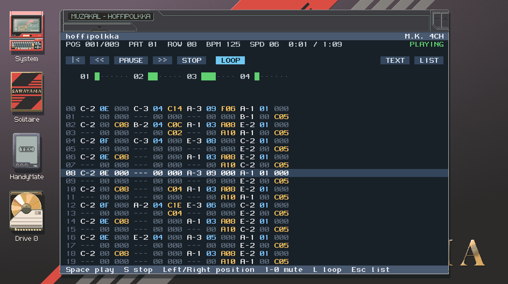

# Muzakal for Last Call BBS

A desktop program that plays Protracker modules (`.mod`) through the game's audio.

## Playing

Put modules in `mods/TrackerPlayer/modules/`. Free modules are on [The Mod Archive](https://modarchive.org/).

Protracker and compatible modules, multichannel modules (`6CHN`, `8CHN`, `28CH`, and so on, up to 32 channels), and 15-sample Soundtracker modules are accepted.

| Key | Effect |
|---|---|
| Space | Play or pause. |
| S | Stop. |
| Home | Restart. |
| Left, Right | Previous or next position. |
| 1 to 0 | Mute a channel. |
| [, ] | Scroll channels. |
| Tab | Page through channels. |
| L | Loop song. |
| T | Show module text. |
| Esc | Back to module list. |

Buttons do the same. Click a channel number to mute it, right-click to solo.

## Module text

The TEXT page lists the sample names in order and marks the samples playing. Text stored after the sample data follows them.

## Menu

| Item | Effect |
|---|---|
| Mute Music | The game's music while the window is open. Desktop silences the desktop's music; All also silences full-screen games. |
| Filter | Amiga 500 or 1200 output filters, or none. |
| Stereo | Mono, or 20, 50, or 100% of the Amiga's hard left and right panning. |

## Files

`Documents/My Games/Last Call BBS/<user>/mods/onehalf.trackerplayer/preferences.ini` holds menu choices.

Window size, module folder, volume, and amplification are set in `mods/TrackerPlayer/config.ini`.
